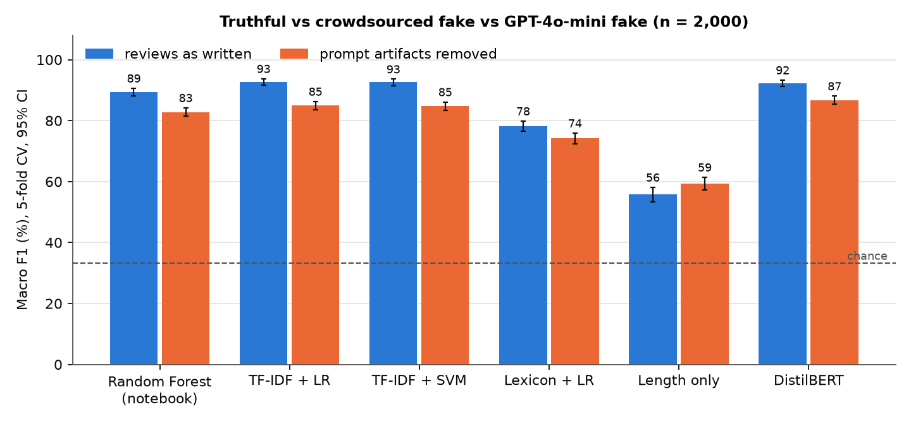
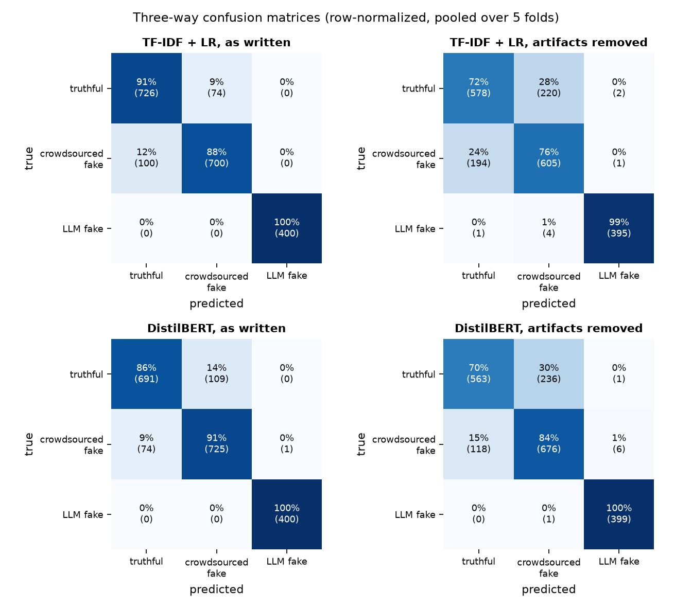
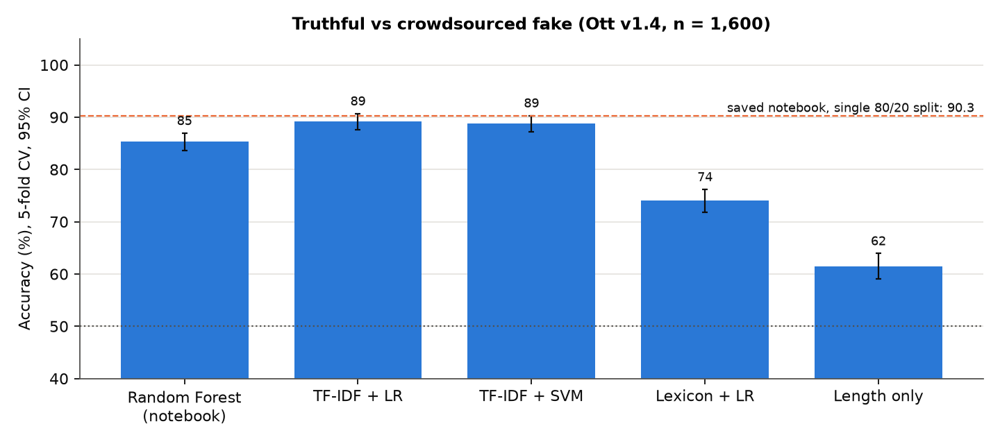
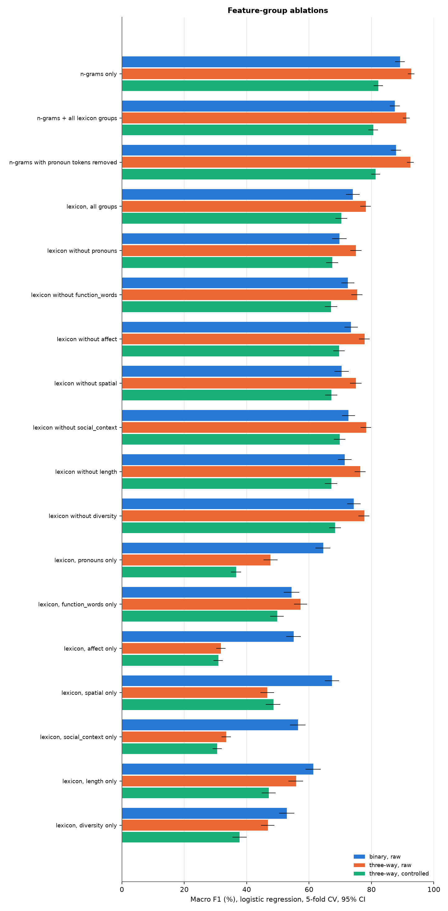

# Fake reviews analysis

Can a detector tell a real hotel review from a fake written by a paid crowd worker, and from a fake written by an LLM? This repo builds a three-way detector (truthful / crowdsourced fake / GPT-4o-mini fake) on the Ott Deceptive Opinion Spam corpus plus 400 GPT-4o-mini reviews, under hotel-disjoint 5-fold cross-validation.

**Result.** TF-IDF logistic regression reaches **92.7% macro F1** (95% CI 91.7 to 93.7) on the three-way task, and a fine-tuned DistilBERT reaches 92.3 (91.3 to 93.3). GPT-4o-mini reviews are the easy class: 400 of 400 are recalled. The hard pair is still truthful vs crowdsourced fake: 9% of truthful reviews are called crowdsourced and 12.5% of crowdsourced fakes are called truthful. After removing the traces the generation prompt left (fixed openings, required phrases, no hotel names, fixed length, non-ASCII characters), macro F1 drops to 85.0 (83.6 to 86.3) for logistic regression and 86.7 (85.4 to 88.0) for DistilBERT, while LLM recall stays at 99.5% and 100%. The drop comes from the truthful vs crowdsourced pair, which also falls on its own under the same edits (binary accuracy 89.2 to 77.8). LLM detection learned on one sentiment transfers only partly to the other (LLM recall 59.5% training on positive and testing on negative).



## Results

All numbers come from `results/tables.md` (written by `python src/summarize.py`). Percentages with 95% bootstrap CIs over pooled out-of-fold predictions. Five Ott folds, each holding 4 of the 20 hotels.

### Three-way: truthful / crowdsourced fake / LLM fake (n = 2,000)

| Model | View | Accuracy | Macro F1 | Recall truthful | Recall crowdsourced | Recall LLM |
| --- | --- | --- | --- | --- | --- | --- |
| TF-IDF 1-2 gram + logistic regression | as written | 91.3 [90.0, 92.5] | 92.7 [91.7, 93.7] | 90.8 | 87.5 | 100.0 |
| TF-IDF 1-2 gram + linear SVM | as written | 91.1 [89.8, 92.3] | 92.6 [91.5, 93.6] | 90.6 | 87.1 | 100.0 |
| Random Forest (notebook features) | as written | 87.3 [85.8, 88.8] | 89.4 [88.1, 90.6] | 83.2 | 85.0 | 100.0 |
| Lexicon features + logistic regression | as written | 75.6 [73.6, 77.5] | 78.2 [76.5, 79.8] | 69.2 | 72.4 | 95.0 |
| DistilBERT fine-tune | as written | 90.8 [89.5, 92.0] | 92.3 [91.3, 93.3] | 86.4 | 90.6 | 100.0 |
| Length only + logistic regression | as written | 55.9 [53.4, 58.0] | 55.9 [53.4, 58.1] | 54.0 | 57.2 | 56.8 |
| TF-IDF 1-2 gram + logistic regression | controlled | 82.0 [80.4, 83.7] | 85.0 [83.6, 86.3] | 76.5 | 78.8 | 99.5 |
| TF-IDF 1-2 gram + linear SVM | controlled | 81.8 [80.2, 83.5] | 84.8 [83.4, 86.1] | 75.9 | 78.8 | 99.8 |
| Random Forest (notebook features) | controlled | 79.5 [77.6, 81.2] | 82.8 [81.4, 84.2] | 71.1 | 77.6 | 99.8 |
| Lexicon features + logistic regression | controlled | 71.0 [69.2, 72.9] | 74.2 [72.5, 75.9] | 63.6 | 67.1 | 93.5 |
| DistilBERT fine-tune | controlled | 84.2 [82.7, 85.8] | 86.7 [85.4, 88.0] | 73.0 | 87.4 | 100.0 |
| Length only + logistic regression | controlled | 58.4 [56.2, 60.6] | 59.3 [57.2, 61.4] | 51.6 | 59.6 | 69.2 |
| TF-IDF 1-2 gram + logistic regression | controlled, floor/view/lobby also deleted | 81.8 [80.1, 83.5] | 84.8 [83.4, 86.1] | 76.4 | 78.5 | 99.5 |

"Controlled" applies the same edits to every class: fold to ASCII, drop the first sentence, delete the six prompt seed phrases and all hotel names, keep the first 60 words. The last row also deletes "floor", "view", and "lobby", the words the prompt suggested as spatial details. In the controlled view the largest LLM coefficients are those words and phrases built on them ("third floor", "the lobby"), followed by "stunning", "making", "felt", and "overall" (`results/top_ngrams.csv`).



### Binary: truthful vs crowdsourced fake (Ott v1.4, n = 1,600)

Precision, recall, and F1 are for the deceptive class.

| Model | Accuracy | Precision | Recall | F1 | Fold 5 held out (n = 320) |
| --- | --- | --- | --- | --- | --- |
| TF-IDF 1-2 gram + logistic regression | 89.2 [87.6, 90.7] | 90.7 [88.6, 92.7] | 87.4 [84.9, 89.7] | 89.0 [87.3, 90.7] | 92.2 [89.1, 95.0] |
| TF-IDF 1-2 gram + linear SVM | 88.8 [87.2, 90.3] | 89.9 [87.8, 92.0] | 87.2 [84.8, 89.7] | 88.6 [86.9, 90.2] | 92.2 [89.1, 95.0] |
| Random Forest (notebook features) | 85.3 [83.6, 86.9] | 84.4 [82.0, 86.8] | 86.6 [84.2, 89.0] | 85.5 [83.7, 87.2] | 86.2 [82.2, 90.0] |
| Lexicon features + logistic regression | 74.0 [71.9, 76.2] | 73.6 [70.4, 76.5] | 74.9 [71.9, 77.8] | 74.2 [71.8, 76.6] | 75.6 [70.6, 80.3] |
| Length only + logistic regression | 61.5 [59.1, 63.9] | 60.2 [56.8, 63.2] | 68.1 [64.9, 71.4] | 63.9 [61.1, 66.5] | 59.4 [54.1, 64.7] |
| DistilBERT fine-tune | | | | | 89.1 [85.6, 92.5] |

DistilBERT was run on the fold-5 split only for the binary task (train on folds 1 to 4).

**Does the earlier 90.3% reproduce?** Yes on its own split, not as a general estimate. `python src/reproduce_notebook.py` re-runs the saved notebook (same row order, `train_test_split(random_state=0)`, same forest) and gets 90.6% [87.5, 93.8] on that split (the notebook printed 90.3%; the 0.3-point gap is one review out of 320, likely library versions). Twenty other split seeds give a mean of 85.6% (sd 2.0, range 80.0 to 88.1). Under hotel-disjoint 5-fold CV the same forest scores 85.3%. The 90.3% was a favorable split.



### Ablations

Logistic regression, macro F1. Full table in `results/tables.md`.

| Features | Binary | Three-way | Three-way, controlled |
| --- | --- | --- | --- |
| n-grams only | 89.2 | 92.7 | 85.0 |
| n-grams + all lexicon groups | 87.5 | 91.2 | 84.5 |
| n-grams with pronoun tokens removed | 87.9 | 92.5 | 84.6 |
| lexicon, all groups | 74.0 | 78.2 | 74.2 |
| lexicon without pronouns | 69.7 | 75.1 | 72.9 |
| lexicon without spatial | 70.4 | 75.0 | 70.0 |
| lexicon without length | 71.4 | 76.4 | 69.1 |
| lexicon, pronouns only | 64.5 | 47.6 | 38.4 |
| lexicon, spatial only | 67.3 | 46.6 | 45.8 |

Pronouns and spatial words carry the most lexicon signal for truthful vs crowdsourced, in line with Ott et al.; on their own they separate the three classes poorly (macro F1 47.6 and 46.6). Adding the lexicon features to n-grams does not improve on n-grams alone.



### Cross-domain (train on one polarity, test on the other)

| Task | Model | Positive to negative: acc / macro F1 | Negative to positive: acc / macro F1 | LLM recall, pos to neg / neg to pos |
| --- | --- | --- | --- | --- |
| binary | TF-IDF + logistic regression | 75.9 / 75.3 | 80.5 / 80.1 | |
| binary | TF-IDF + linear SVM | 75.8 / 75.2 | 80.9 / 80.5 | |
| binary | Random Forest (notebook) | 73.8 / 73.7 | 74.5 / 73.4 | |
| three-way | TF-IDF + logistic regression | 72.6 / 72.7 | 82.5 / 84.5 | 59.5 / 91.0 |
| three-way | TF-IDF + linear SVM | 77.8 / 80.1 | 83.7 / 85.9 | 85.0 / 96.0 |
| three-way | Random Forest (notebook) | 71.5 / 73.0 | 76.9 / 79.3 | 65.5 / 91.0 |

Raw view. CIs and the controlled view are in `results/tables.md`.

## Method

- **Protocol.** Ott's five shipped folds are hotel-disjoint (4 hotels each). Each fold is the test set once. LLM reviews, which name no hotel, are assigned round-robin (80 per fold). Linear models choose C by inner 3-fold CV on the training folds. Seed 0 throughout.
- **Models.** The saved notebook's Random Forest (PMI-filtered 1-3 gram counts plus six length and pronoun counts); TF-IDF word 1-2 grams into logistic regression or a linear SVM; 21 LIWC-style lexicon features (open word lists, not LIWC) into logistic regression; a length-only floor; DistilBERT (`distilbert-base-uncased`) fine-tuned for 3 epochs at lr 5e-5, max 256 tokens, on Apple MPS.
- **Metrics.** Accuracy, macro and per-class precision/recall/F1, confusion matrices; 95% percentile bootstrap (2,000 resamples).
- **Two text views.** "As written" and "controlled", described above, to separate style from generation artifacts.

Details: [`docs/methodology.md`](docs/methodology.md).

## Data

| Class | n | Source | License |
| --- | --- | --- | --- |
| truthful | 800 | Ott Deceptive Opinion Spam v1.4 (TripAdvisor and other travel sites) | CC BY-NC-SA 3.0, fetched by script, not in git |
| crowdsourced fake | 800 | same corpus, Mechanical Turk | CC BY-NC-SA 3.0, fetched by script, not in git |
| LLM fake | 400 | GPT-4o-mini via Azure OpenAI, persona and polarity prompts (`src/generator.py`) | synthetic, in `data/llm_generated/`, MIT |

How the LLM reviews were generated, their known artifacts, and citations: [`docs/DATA.md`](docs/DATA.md).

## Reproduce

Python 3.12. Commands run from the repo root.

```bash
python -m venv .venv && source .venv/bin/activate
pip install -r requirements.txt
python -m nltk.downloader stopwords wordnet averaged_perceptron_tagger_eng

python scripts/fetch_data.py          # Ott v1.4 into data/op_spam_v1.4 (sha256 checked)
python src/reproduce_notebook.py      # saved-notebook split re-run, ~2 min
python src/run_experiments.py         # classical models, ablations, cross-domain, ~25 min
python src/prompt_word_check.py       # controlled view minus floor/view/lobby
python src/top_features.py            # results/top_ngrams.csv
python src/summarize.py               # results/summary.json, results/tables.md
python src/make_figures.py            # results/figures/*.png

# DistilBERT (slow: 5 to 15 min per fold on an M-series GPU)
python src/transformer.py --task three_way --view raw
python src/transformer.py --task three_way --view controlled
python src/transformer.py --task binary --view raw --folds 5
python src/summarize.py && python src/make_figures.py
pytest -q
```

Generating new LLM reviews needs an Azure OpenAI deployment: `pip install -r requirements-generation.txt`, copy `.env.example` to `.env`, fill the `AZURE_*` values, then `python src/main.py`. The committed results use the 400 reviews already in `data/llm_generated/`.

## Repo layout

```
src/corpus.py            three-way loader, folds, controlled view
src/lexicon.py           LIWC-style feature groups
src/models.py            Random Forest, TF-IDF LR/SVM, lexicon models, ablations
src/transformer.py       DistilBERT fine-tune on the same folds
src/run_experiments.py   cross-validation and cross-domain runs
src/summarize.py         bootstrap metrics and tables
src/make_figures.py      README figures
src/reproduce_notebook.py  saved-notebook split re-run
src/generator.py, main.py, review_eval.py  LLM review generation (Azure OpenAI)
scripts/fetch_data.py    Ott corpus download and checksum
data/llm_generated/      400 GPT-4o-mini reviews (synthetic)
notebooks/               original exploratory notebooks
results/                 predictions, summary.json, tables.md, figures
docs/                    DATA.md, methodology.md, third_party.md
```

## Limitations

- One generator (GPT-4o-mini), one prompt template, one temperature, one domain (Chicago hotels, Ott reviews from 2011 to 2013). Near-perfect LLM recall here is a statement about this generator and prompt, not about LLM text in general.
- The prompt's fixed structure is the main reason the LLM class is easy. The controlled view removes the known traces, but persona-driven topics and the model's own phrasing remain.
- The LLM reviews were screened at generation time by a classifier fit on all Ott reviews (`src/review_eval.py`).
- CIs reflect test-set sampling, not training variance across seeds. DistilBERT was trained once per fold with seed 0; MPS kernels are not bit-for-bit deterministic.
- DistilBERT was not run for the binary 5-fold CV or the cross-domain check; those comparisons use the classical models.

## License

MIT for original code and for the synthetic reviews in `data/llm_generated/`. The Ott corpus is CC BY-NC-SA 3.0 and is not redistributed. Classifier notebooks and parts of `src/` started from [PauDK/Deceptive-Review-Detection](https://github.com/PauDK/Deceptive-Review-Detection); see [`docs/third_party.md`](docs/third_party.md).
